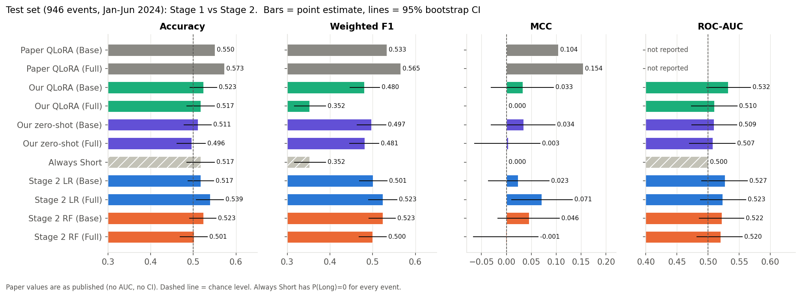

# Earnings-Based Stock Direction Classification with QLoRA

Fine-tuning **Llama 3 8B Instruct** on financial earnings data using **4-bit QLoRA**, followed by a comparison with Logistic Regression and Random Forest.

This research implementation adapts the approach in *Harnessing Earnings Reports for Stock Predictions: A QLoRA-Enhanced LLM Approach* (Ni et al., 2024; arXiv:2408.06634v2). It rebuilds the data from public sources, completes separate fine-tuning runs on **Base** and **Full** input variants, and evaluates all models on a shared chronological holdout.

**Main finding:** the experiments did not establish a reliable predictive signal for this target. The value of the project is its implemented fine-tuning pipeline, model diagnostics, and reproducible evaluation.

## Project at a glance

| Component | Implementation |
| --- | --- |
| Base model | `unsloth/llama-3-8b-Instruct-bnb-4bit` |
| Adaptation | QLoRA with rank-16 LoRA adapters |
| Training framework | Unsloth, Hugging Face Transformers, TRL, PyTorch |
| Training hardware | NVIDIA Tesla T4 on Kaggle |
| Dataset | 8,271 earnings events from 481 S&P 500 companies |
| Fine-tuning runs | Base and Full; 3,000 balanced training examples per run |
| Final holdout | 946 earnings events from January-June 2024 |
| Comparisons | Zero-shot Llama 3, Logistic Regression, Random Forest, Always Short |

## Prediction task

For each earnings call, predict the open-to-close direction of the first eligible trading session:

- **Long:** closing price is greater than opening price.
- **Short:** closing price is less than or equal to opening price.

Calls before 09:30 US Eastern use that day's session; later calls use the next trading session. This label excludes the overnight opening gap.

## Dataset and input variants

The reconstructed dataset covers January 2020-June 2024. Sources used in the project include the `kurry/sp500_earnings_transcripts` Hugging Face dataset, SEC EDGAR companyfacts, Yahoo Finance through `yfinance`, and a historical S&P 500 company list.

The two variants describe the **same earnings events with different input features**, rather than two unrelated datasets:

| Variant | Model input |
| --- | --- |
| Base | Earnings transcript summary plus 12 year-over-year financial growth metrics |
| Full | Base inputs plus stock, SPY, QQQ and Dow past-week returns, EPS surprise, and analyst grade |

The 12 growth metrics cover revenue, gross profit, operating income, net income, diluted EPS, operating cash flow, capital expenditure, total assets, total liabilities, shareholders' equity, cash and cash equivalents, and free cash flow. Financial values are converted into sentences for the LLM.

### Chronological evaluation

| Partition | Period | Available events | Used for final LLM runs |
| --- | --- | ---: | ---: |
| Train | January 2020-June 2023 | 6,387 | 3,000 |
| Validation | July-December 2023 | 938 | 500 |
| Test | January-June 2024 | 946 | 946 |

Training samples were balanced between Long and Short. Stage 2 uses the full training and validation partitions. Model selection uses validation data; test events are held out from training and selection.

## Stage 1: LLM fine-tuning

### Transcript preparation

A deterministic extractive summarizer scores sentences using financial keywords and numerical information. It removes operator turns and boilerplate, allocates space to both prepared remarks and Q&A, and preserves selected sentences in their original order.

The summary budget is approximately 8,500 characters, allowing the features and summary to fit within the 3,072-token context. This operates on stored transcripts, which were already capped at 40,000 characters; it cannot recover text removed by that earlier cap.

### Training configuration

| Setting | Value |
| --- | --- |
| Base weights | Frozen, loaded in 4-bit precision |
| LoRA rank / alpha / dropout | 16 / 16 / 0 |
| Target modules | `q_proj`, `k_proj`, `v_proj`, `o_proj`, `gate_proj`, `up_proj`, `down_proj` |
| Maximum sequence length | 3,072 tokens |
| Epochs | 1 |
| Learning rate | 0.0002 |
| Optimizer | 8-bit AdamW |
| Weight decay | 0.01 |
| Schedule | Linear, 5 warm-up steps |
| Batch size / accumulation | 1 / 8; effective batch size 8 |
| Training objective | Cross-entropy on assistant answer tokens only |
| Completed optimizer steps | 375 per final run |
| Seed | 3407 |

The saved run metadata records **330.0 minutes** for Base training and **375.6 minutes** for Full training. Both completed their planned steps without a time-budget stop. These are training times, not end-to-end pipeline or inference timings.

At evaluation, the pipeline scores the `Long` and `Short` next-token logits to obtain a binary probability. The project also investigates numerical precision and uses FP32 scoring to address half-precision probability ties. The main comparison below uses the default 0.5 threshold; validation-derived thresholds are recorded separately.

## Stage 2: Numerical baselines

To test the numerical information independently of the transcript, the pipeline extracts the financial features from the Stage 1 prompt text and trains Logistic Regression and Random Forest on Base and Full variants.

The preprocessing pipeline includes a signed-log transformation, training-set median imputation, missing-value indicators, categorical encoding, and scaling where applicable. Preprocessing is fitted on training data, and hyperparameters are selected using validation ROC-AUC.

Round-trip checks verify feature extraction, and cross-stage checks ensure identical test event IDs and labels. Evaluation includes accuracy, weighted F1, MCC, ROC-AUC, bootstrap confidence intervals, and paired bootstrap AUC comparisons.

## Results




All project results below use the same **946 test events**. Values are rounded from `stage2/results/metrics/comparison_test.csv`.

| Model | Variant | Accuracy | Weighted F1 | MCC | ROC-AUC |
| --- | --- | ---: | ---: | ---: | ---: |
| Always Short | - | 0.517 | 0.352 | 0.000 | 0.500 |
| Zero-shot Llama 3 | Base | 0.511 | 0.497 | 0.034 | 0.509 |
| Zero-shot Llama 3 | Full | 0.496 | 0.481 | 0.003 | 0.507 |
| QLoRA Llama 3 | Base | 0.523 | 0.480 | 0.033 | 0.532 |
| QLoRA Llama 3 | Full | 0.517 | 0.352 | 0.000 | 0.510 |
| Logistic Regression | Base | 0.517 | 0.501 | 0.023 | 0.527 |
| Logistic Regression | Full | 0.539 | 0.523 | 0.071 | 0.523 |
| Random Forest | Base | 0.523 | 0.523 | 0.046 | 0.522 |
| Random Forest | Full | 0.501 | 0.500 | -0.001 | 0.520 |

### Interpretation

- QLoRA Base achieved the highest observed ROC-AUC, **0.532**, but its bootstrap interval included 0.5.
- QLoRA Full predicted Short for every test event at the default threshold. Its 51.7% accuracy therefore matched the majority baseline and its MCC was zero.
- Logistic Regression Full achieved the highest observed accuracy, **53.9%**, but this does not establish superiority over the LLM.
- All 24 recorded paired bootstrap AUC comparisons used 2,000 resamples and had p-values of at least **0.139**. No tested AUC difference was significant at the 0.05 level.

These findings do not prove that the models are equivalent or that earnings information can never predict returns. They indicate that this experiment did not establish reliable discrimination under its data, target, and evaluation setup.

## Project layout

This repository includes the final source code, clean notebooks, saved evaluation evidence, plots, and combined report. Large datasets, model weights, superseded experiments, logs, and duplicate reports are excluded.

```text
stage1/
  1_data/                 Instructions for supplying local datasets
  2_code/                 Dataset builder, summarizer, scoring code, tests
  3_notebooks/            Training/evaluation and prediction notebooks
  4_results/              Saved metrics and per-event predictions
  5_reports/              Summarization documentation
stage2/
  data/                   Feature dictionary and extraction checks
  notebooks/              Step-by-step numerical-model workflow
  src/                    Preprocessing, training, evaluation, visualization
  results/                Metrics, predictions, and plots
  requirements.txt
Submission/               Combined final report
```

## Reproducing the experiments

### Stage 1: Kaggle GPU

1. Prepare `stage1/1_data/llm_data_sum.jsonl.gz` and `stage1/2_code/llm_stage1.py` as Kaggle inputs.
2. Import `stage1/3_notebooks/1_Train_and_Evaluate.ipynb` and enable a compatible GPU environment.
3. Check the notebook's input paths and dependency setup.
4. Set `DATASET = "base"` or `"full"`, then `MODE = "train_eval"` to train or `"zeroshot"` to evaluate the unadapted model.
5. Run the notebook and retain its adapter outputs, predictions, configurations, and metrics.

Use `2_Predict_New_Transcript.ipynb` for the separate prediction workflow. The dataset builder and its README under `stage1/2_code/dataset_builder/` document upstream data reconstruction. Rebuilding from live providers may produce different coverage from the archived dataset.

### Stage 2: CPU

From the project root, with the original Stage 1 data and comparison predictions available:

```bash
pip install -r stage2/requirements.txt
python stage2/src/run_all.py
python stage2/src/predict_demo.py --dataset full --event NVDA_2024-02-21
```

The pipeline extracts and verifies features, trains numerical models, compares predictions, generates plots, and runs integrity checks. It regenerates outputs under `stage2/results/`.

Large datasets and trained artifacts are not included in this repository, and no public artifact download is configured. See [data setup](stage1/1_data/README.md) for the required local files. Reproduction requires supplying those files or rebuilding the data; a source-only checkout cannot rerun training or the full Stage 2 pipeline.

## Limitations and next steps

- GPU constraints limited LLM training to 3,000 examples and 3,072 tokens, compared with the source paper's longer context.
- Public-source substitutions and the company universe differ from the original study, so this is an adapted reproduction rather than an identical benchmark.
- Transcript storage truncation and extractive summarization discard information.
- One chronological holdout does not establish performance across market periods, and time splitting alone does not eliminate every possible source of dataset bias.
- The target excludes overnight returns. Whether alternative targets contain a stronger signal remains untested here.

Potential extensions include rolling temporal evaluation, alternative return horizons, and combining transcript embeddings with numerical features.

## Skills demonstrated

Parameter-efficient LLM fine-tuning, 4-bit model loading, response-only supervised training, GPU-constrained experimentation, financial data preparation, numerical debugging, chronological evaluation, baseline modeling, and statistical interpretation.

## Attribution and evidence

Research basis: H. Ni et al., *Harnessing Earnings Reports for Stock Predictions: A QLoRA-Enhanced LLM Approach*, arXiv:2408.06634v2 (2024).

The implementation and metrics documented here were checked against the training notebook, final summarized-run JSON files, Stage 2 comparison CSV, and paired bootstrap CSV. Where presentation slides differ from these artifacts, the saved experiment configuration and metrics take precedence.

Model and upstream dataset usage remain subject to their respective terms.

## Report

[Read the combined project report](Submission/Final_Project_Report_without_student_details.pdf). Historical presentation slides are omitted because some settings and numbers differ from the saved experiments.
